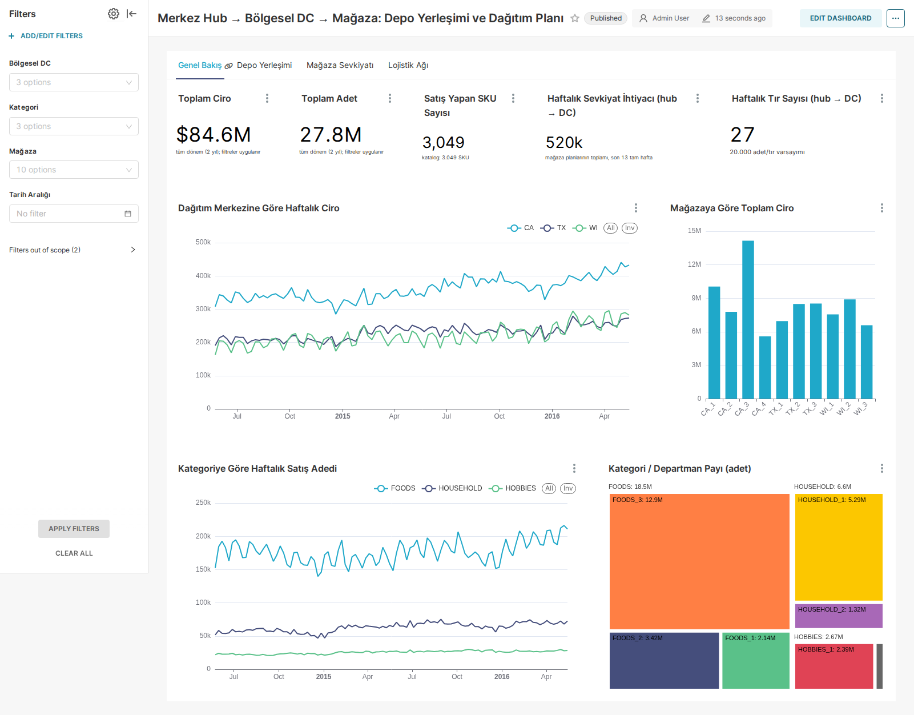

# Bölgesel Dağıtım Merkezinde Talep Odaklı Depo Yerleşimi ve Mağaza Dağıtım Planlaması

**YBS305 İş Zekâsı ve Veri Madenciliği – Dönem Projesi (2026–2027 Güz)** · Öğretim Elemanı: Ece Dalpolat · **Grup 6**
Bölüm 1: Veri → dbt ETL → Dashboard

| | |
|---|---|
| **Canlı dashboard** | https://wallmart.duckdns.org/superset/dashboard/dc-planning/ |
| **dbt docs** | https://wallmart.duckdns.org/dbt-docs/ |
| **Veri sözlüğü** | [docs/veri_sozlugu.md](docs/veri_sozlugu.md) |

## 1. İş problemi

Bir perakende zincirinin **merkez hub'ı**, üç eyaletteki **bölgesel dağıtım merkezlerini (DC)** besler; her bölgesel DC kendi eyaletindeki
mağazalara mal sevk eder (toplam 10 mağaza, 3.049 SKU). Modellenen hub süreci dört adımdan oluşur:

| Adım | Soru | Çıktı (mart) |
|---|---|---|
| 1. Talep | Her mağaza / bölge / kategori için gelecek haftanın talebi nedir? | `fct_sales_weekly`, `mart_store_replenishment` (ortalama + emniyet stoku); tahmin modeli Bölüm 2'de |
| 2. Depo yerleşimi | Hub ve her bölgesel DC'de hangi SKU rampaya yakın (hızlı) bölgeye, hangisi uzak bölgeye konmalı? | `mart_sku_abc_xyz` → **HOT** (rampaya yakın, hızlı ve düzenli), **WARM**, **COLD** (uzak raf, yavaş/düzensiz) |
| 3. Dağıtım (sevkiyat) planı | Her mağazaya her SKU'dan haftada kaç adet gönderilmeli? Her bölgesel DC hub'dan haftada kaç tır ister? | `mart_store_replenishment`, `mart_hub_supply_plan` |
| 4. Teslimat sıklığı | Her mağazaya haftada kaç kez teslimat yapılmalı (mesafe, süre, taşıma ve stok maliyeti)? | `mart_delivery_options`, `mart_delivery_plan` |

**Karar çıktısı:** SKU → depo bölgesi listesi (hub ve her DC için), SKU × mağaza haftalık sevkiyat miktarı, mağaza başına optimum teslimat
sıklığı ve hub → DC haftalık tır planı (tedarik süresi ve maliyetle birlikte).

## 2. Veri kaynakları

| # | Kaynak | İçerik | Kullanım |
|---|---|---|---|
| 1 | **Kaggle M5 Forecasting – Accuracy** (Walmart) | 3.049 SKU × 10 mağaza (CA ×4, TX ×3, WI ×3) × 1.941 gün satış adedi; haftalık fiyatlar; takvim (etkinlik, SNAP) | Ana veri (omurga) |
| 2 | **Open-Meteo Historical Weather API** | Mağaza şehirleri için günlük sıcaklık ve yağış | Talep üzerindeki hava etkisi |
| 3 | **OSRM / OpenStreetMap** yol ağı (`/table` API) | Hub → DC → mağaza yol mesafesi (km) ve sürüş süresi | Tedarik süresi, sefer maliyeti, teslimat sıklığı |
| 4 | **EIA dizel fiyatları** (FRED üzerinden: GASDESW, GASDESGCW, GASDESMWW) | Haftalık bölgesel dizel fiyatı (USD/gal) | Sefer maliyetinin yakıt bileşeni |
| 5 | **ATRI – Operational Costs of Trucking (2016)** | Tır başına mil maliyeti ($1,59/mil; yakıt $0,336/mil) | Sefer maliyeti parametreleri (`dbt/seeds/cost_params.csv`) |
| 6 | **SPS Commerce Walmart DC listesi** | Gerçek Walmart bölgesel DC adresleri | DC konumları (`dbt/seeds/dc_locations.csv`) |

**Varsayımlar (açıkça belirtilmiştir):**
- M5 mağazaları anonimdir (CA_1 … WI_3). Her mağaza için eyaletin büyük bir şehri varsayılmıştır (`dbt/seeds/store_locations.csv`).
- Bölgesel DC'ler gerçek Walmart RDC konumlarıdır: **Porterville, CA (DC 6021)**, **New Braunfels, TX (DC 6016)**, **Beaver Dam, WI (DC 7039)**.
  Merkez hub olarak Walmart'ın genel merkezi ve ilk DC'sinin bulunduğu **Bentonville, AR** alınmıştır.
- Tır kapasitesi 20.000 birim/sefer, yakıt tüketimi 6,5 mil/gal, yıllık stok taşıma oranı %25, DC elleçleme süresi 1 gün.
- Kaliforniya için FRED'de ayrı dizel serisi olmadığından ABD ortalaması kullanılmıştır.
- **Kapsam:** 24.05.2014 – 22.05.2016 (son 2 yıl) → 22,3 milyon günlük satış satırı. Sıfır satış günleri **korunur** (kesikli talep analizi için gereklidir).

## 3. Mimari ve teknoloji yığını

```
M5 CSV + Open-Meteo + OSRM + FRED/EIA ──▶ DuckDB (dbt-duckdb) ──▶ Apache Superset (Docker, HTTPS)
   data/raw, data/external, dbt/seeds       staging → marts          dashboard: 4 sekme, filtreler
```

| Katman | Araç | Not |
|---|---|---|
| Veri ambarı | DuckDB | El kitabındaki ana araç |
| ETL | dbt Core 1.12 + dbt-duckdb | 6 staging + 12 mart modeli, 3 seed, 63 test, dbt docs |
| Görselleştirme | **Apache Superset 4.1** (Docker) | El kitabında alternatif olarak izin verilen açık kaynak araç; gerekçe aşağıda |
| Yayın | Docker Compose + Caddy (Let's Encrypt) | Ücretsiz DuckDNS alan adı, HTTPS |

**Neden Power BI yerine Superset?** (1) Dashboard'un herkese açık bir linkle paylaşılması gerekiyordu; Power BI Service yayını kurumsal lisans ister.
(2) Superset dbt'nin ürettiği DuckDB dosyasını `duckdb-engine` ile doğrudan okur; ara dışa aktarma adımı gerekmez. (3) Dashboard tamamen kodla
(`superset/bootstrap_dashboard.py`) üretilir ve repo'dan yeniden kurulabilir. (4) Ekip Linux sunucu üzerinde çalışmaktadır.

## 4. dbt modelleri

```
models/
├─ staging/                (view)
│  ├─ stg_calendar          takvim: gün anahtarı, Walmart haftası, hafta sonu / etkinlik / eyalet bazlı SNAP bayrakları
│  ├─ stg_sales_long        geniş → uzun format (UNPIVOT d_1212..d_1941), CA+TX+WI   [table, 22,3 M satır]
│  ├─ stg_prices            SKU × mağaza × hafta fiyatı
│  ├─ stg_weather           Open-Meteo günlük hava durumu (10 şehir)
│  ├─ stg_routes            OSRM mesafe/süre matrisi (hub, DC, mağaza)
│  └─ stg_diesel_prices     haftalık bölgesel dizel fiyatı
└─ marts/                  (table)
   ├─ dim_product, dim_store, dim_dc
   ├─ fct_sales_daily            SKU × mağaza × gün: adet, fiyat, ciro, takvim + hava bayrakları
   ├─ fct_sales_weekly           haftalık toplam (+ is_complete_week)
   ├─ fct_route                  HUB→DC ve DC→mağaza bacakları: km, saat, tedarik süresi, sefer maliyeti (ATRI + dizel)
   ├─ mart_sku_abc_xyz           depo seviyesi (HUB / CA / TX / WI) × SKU: ABC (ciro %80/%95) × XYZ (CV 0,5/1,0) → bölge, toplama sırası
   ├─ mart_store_replenishment   SKU × mağaza: son 13 tam hafta ort. talep + emniyet stoku (z = 1,65) → önerilen haftalık sevkiyat
   ├─ mart_delivery_options      mağaza × teslimat sıklığı (1/2/3/5/7): taşıma + stok taşıma maliyeti
   ├─ mart_delivery_plan         mağaza başına toplam maliyeti en küçükleyen sıklık ve sefer sayısı
   ├─ mart_hub_supply_plan       hub → DC haftalık ihtiyaç, tır sayısı, tedarik süresi, yoldaki stok, maliyet
   └─ mart_calendar_effects      DC × kategori × gün tipi × hava: taban çizgisine göre talep artışı
```

**Testler (63):** `unique`, `not_null`, `accepted_values`, `relationships`, bileşik tekillik testleri ve 4 özel (singular) test:
negatif satış yok; her depo seviyesinde A sınıfı ciro payı %75–85 aralığında; önerilen sevkiyat ≥ ortalama talep; seçilen teslimat planı
haftalık adedi taşıyabilir.

## 5. Dashboard



Sekmeler (filtreler: Dağıtım Merkezi, Kategori, Mağaza, Depo Bölgesi, Tarih Aralığı):

1. **Genel Bakış** – ağ KPI'ları (toplam ciro, adet, SKU sayısı, haftalık sevkiyat ihtiyacı, haftalık tır sayısı), DC bazında haftalık ciro, mağaza karşılaştırması, kategori/departman ağaç haritası.
2. **Depo Yerleşimi** – seçilen depo seviyesi (hub veya bölgesel DC) için ABC × XYZ ısı haritası, bölge başına SKU sayısı ve adet/ciro payı, sınıfa göre sıfır satış günü oranı, departman × bölge, toplama sırası tablosu.
3. **Mağaza Sevkiyatı** – mağaza × kategori önerilen haftalık sevkiyat, haftanın günü profili, gün tipi (hafta sonu / SNAP / etkinlik) ve yağış etkisi, SKU × mağaza sevkiyat planı tablosu.
4. **Lojistik Ağı** – hub → DC haftalık tır sayısı, adet başına taşıma maliyeti ve ikmal planı tablosu (mesafe, tedarik süresi, dizel, yoldaki stok); mağaza başına optimum teslimat sıklığı, sıklığa göre maliyet eğrisi (taşıma + stok taşıma) ve mağaza teslimat planı tablosu.

Depo Yerleşimi sekmesinde "Mağaza" ve "Tarih Aralığı" filtreleri kapsam dışıdır: ABC/XYZ sınıfı depo seviyesinde (hub veya DC toplamı) ve sabit 52 haftalık pencerede hesaplanır. Superset arayüzü İngilizce sayı biçimi kullanır (80.0%, $37.6M).

### Öne çıkan bulgular (ABC/XYZ: son 52 tam hafta; diğerleri: tüm dönem)
- Hub seviyesinde **1.317 SKU (A sınıfı)** cironun %80'ini üretir; **HOT bölge 1.286 SKU**. Bölgesel DC'lerde HOT listesi farklılaşır: CA 1.282, WI 1.220, **TX 1.074** SKU → her DC'nin kendi yerleşimi olmalı, hub listesi kopyalanmamalı.
- **COLD bölge** her depoda 817–964 SKU; sıfır satış günü oranı %78–83 → uzak raflar, düşük toplama sıklığı.
- FOODS_3 departmanı tek başına adetlerin ~%46'sı → rampaya en yakın bölge.
- Hafta sonu talebi hafta içine göre FOODS'ta **+%33–40**; SNAP hafta içi etkisi bölgeye göre çok farklı: **WI +%33, TX +%17, CA +%10** → sevkiyatlar hafta sonu ve SNAP günleri öncesine planlanmalı.
- Hub → DC haftalık ihtiyaç: CA 218 bin adet (11 tır, 2.610 km, tedarik süresi 3 gün, $0,26/adet), WI 162 bin (9 tır), TX 140 bin (7 tır, $0,10/adet).
- Optimum teslimat sıklığı çoğu mağazada **haftada 3**; DC'ye 51 km uzaklıktaki TX_3 için de 3 (taşıma ucuz, stok maliyeti baskın), 451 km'deki CA_3 için 2 (taşıma pahalı). Madison (WI_2) yüksek hacim + yakınlık → haftada 5.

## 6. Çalıştırma

```bash
# 0) Veri: data/raw/ altına M5 dosyalarını koyun (calendar.csv, sell_prices.csv, sales_train_evaluation.csv)
python3 -m venv .venv && .venv/bin/pip install -r requirements.txt

# 1) Dış kaynaklar → data/external/
python3 data/scripts/fetch_weather.py     # Open-Meteo
python3 data/scripts/fetch_routes.py      # OSRM mesafe/süre matrisi
python3 data/scripts/fetch_diesel.py      # FRED/EIA dizel fiyatları

# 2) dbt: seed + run + test + docs; DuckDB dosyasını Superset'in okuduğu yere atomik olarak kopyalar
./scripts/build_and_publish.sh

# 3) Superset (Docker): superset/.env dosyasını .env.example'dan oluşturun
cd superset && docker compose up -d --build
docker compose exec superset superset db upgrade && docker compose exec superset superset init
docker compose exec superset superset fab create-admin --username admin ...   # .env ile aynı şifre

# 4) Dashboard'u API ile kur ve doğrula
../.venv/bin/python bootstrap_dashboard.py && ../.venv/bin/python verify_charts.py
```

## 7. Repo yapısı

```
├─ data/
│  ├─ raw/            M5 CSV'leri (git'e dahil değil, Kaggle'dan indirin)
│  ├─ external/       weather.csv, routes.csv, diesel_prices.csv
│  ├─ scripts/        fetch_weather.py, fetch_routes.py, fetch_diesel.py
│  └─ warehouse/      DuckDB dosyaları (git'e dahil değil)
├─ dbt/               dbt projesi (models/, seeds/, tests/, profiles.yml)
├─ superset/          docker-compose.yml, Dockerfile, Caddyfile, bootstrap_dashboard.py, verify_charts.py, dashboard_export/
├─ scripts/           build_and_publish.sh
├─ docs/              veri_sozlugu.md, ekran görüntüleri
├─ model/             (Bölüm 2) talep tahmin modeli
├─ app/               (Bölüm 2) Streamlit uygulaması
└─ README.md
```

## 8. Ekip

| Ad Soyad | GitHub | Sorumluluk |
|---|---|---|
| Nurasyl Utepbergen | [@alpmsv02](https://github.com/alpmsv02) | Dokümantasyon, GitHub (README, veri sözlüğü, repo düzeni) |
| Ibrokhimkhuja Askarkhonov | [@ibrahimasqar](https://github.com/ibrahimasqar) | dbt / ETL (staging → mart modelleri, testler, dbt docs) |
| Mukhammadamin Yuldashev | [@yuldoshevm22](https://github.com/yuldoshevm22) | Dashboard (Superset kurulumu, grafikler, sunucu/yayın) |

Grup 6 · Repo: https://github.com/alpmsv02/YBS305-GRUP-6-PROJE

## 9. Kaynaklar ve etik

- M5 Forecasting – Accuracy, Kaggle / University of Nicosia (MOFC). Veri anonimdir, kişisel veri içermez.
- Open-Meteo (CC BY 4.0) – https://open-meteo.com · OSRM demo sunucusu, © OpenStreetMap katkıda bulunanlar (ODbL)
- EIA / FRED (St. Louis Fed) dizel fiyat serileri · ATRI, *An Analysis of the Operational Costs of Trucking* (2017 güncellemesi)
- SPS Commerce, Walmart Receiving Distribution Center List · dbt Labs, Apache Superset, DuckDB belgeleri.
